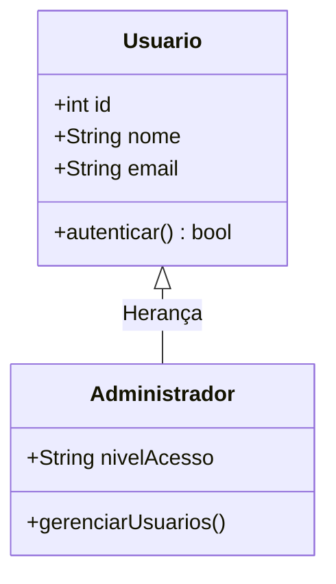

# Tutorial: Instalação e Configuração do Typora no Debian 13 (Trixie)

> O **Typora** é um dos editores de Markdown mais populares e elegantes, oferecendo pré-visualização em tempo real (*live preview*), suporte integrado a equações matemáticas em LaTeX e renderização nativa de diagramas **UML** e **Mermaid**. Este guia ensina o passo a passo completo para instalar, configurar e otimizar o Typora no **Debian 13 (Trixie)**.

---

> [!NOTE]
> O Typora é um software comercial com período de avaliação gratuita (*trial* de 15 dias). Após esse período, é necessário adquirir uma licença para continuar utilizando.

---

## 1. Pré-requisitos do Sistema

Antes de começar, certifique-se de que os pacotes `curl` e `ca-certificates` estão instalados no seu Debian para permitir downloads seguros via HTTPS:

```bash
sudo apt update
sudo apt install -y curl ca-certificates
```

---

## 2. Método 1: Instalação via Repositório Oficial APT (Recomendado)

Utilizar o repositório oficial é a melhor opção, pois garante que o Typora receba atualizações de versão e segurança automaticamente junto com o sistema operacional.

### 2.1. Adicionar a Chave GPG Oficial
Crie o diretório de chaves do APT (padrão moderno das distribuições Debian) e importe a chave criptográfica do Typora:

```bash
sudo mkdir -p /etc/apt/keyrings
curl -fsSL https://downloads.typora.io/typora.gpg | sudo tee /etc/apt/keyrings/typora.gpg > /dev/null
```

### 2.2. Adicionar o Repositório do Typora
Insira o repositório oficial na sua lista de fontes do APT (`sources.list.d`), associando-o diretamente à chave GPG baixada:

```bash
echo "deb [signed-by=/etc/apt/keyrings/typora.gpg] https://downloads.typora.io/linux ./" | sudo tee /etc/apt/sources.list.d/typora.list
```

### 2.3. Atualizar os Índices e Instalar o Typora
Atualize o catálogo de pacotes do sistema e faça a instalação:

```bash
sudo apt update
sudo apt install -y typora
```

---

## 3. Método 2: Instalação Manual via Pacote `.deb`

Se você prefere uma instalação avulsa sem adicionar fontes de terceiros ao APT:

### 3.1. Baixar o Pacote `.deb`
Acesse a [Página de Downloads do Typora](https://typora.io/#linux) ou baixe diretamente pelo terminal via `curl`/`wget`:

```bash
cd ~/Downloads

# Para arquitetura Intel/AMD de 64 bits (amd64 - computadores convencionais):
curl -LO https://downloads.typora.io/linux/typora_1.12.4_amd64.deb

# (Opcional) Para arquitetura ARM de 64 bits (arm64):
# curl -LO https://downloads.typora.io/linux/typora_1.11.7_arm64.deb
```

> [!TIP]
> Caso queira verificar a versão mais recente disponível no repositório, consulte o índice oficial em [downloads.typora.io/linux](https://downloads.typora.io/linux/).

### 3.2. Instalar o Arquivo Local
Instale o pacote utilizando o comando `apt install` passando o caminho relativo, pois assim ele resolverá e instalará automaticamente todas as dependências do sistema:

```bash
sudo apt install ./typora_*.deb
```

---

## 4. Habilitar Suporte a UML e Diagramas (Mermaid)

Como este tutorial faz parte do seu fluxo de documentação e UML, ative o motor de diagramas para renderizar modelos visuais no editor:

1. Abra o Typora e acesse: **Arquivo** > **Preferências** (ou pressione `Ctrl + ,`).
2. No menu lateral esquerdo, clique em **Markdown**.
3. Na seção **Sintaxe Markdown**, marque as opções:
   - [x] **Diagramas** *(habilita Mermaid, Flowcharts e Sequence Diagrams)*
   - [x] **Equações matemáticas** *(LaTeX / KaTeX)*
   - [x] **Tabelas avançadas**
4. Reinicie o Typora para aplicar as alterações.

### Exemplo de Diagrama de Classes UML (Mermaid)
Dentro de um documento Markdown no Typora, basta inserir um bloco de código com o identificador `mermaid`:

````markdown

````

O Typora exibirá instantaneamente a renderização visual do diagrama logo abaixo do código.

---

## 5. Otimizações e Dicas para o Debian 13

### 5.1. Aceleração e Suporte Nativo a Wayland
O Debian 13 utiliza o **Wayland** por padrão nos ambientes GNOME e KDE Plasma. Como o Typora é baseado em Electron, em alguns monitores de alta resolução (HiDPI) ou placas de vídeo ele pode apresentar fontes ligeiramente embaçadas no modo de compatibilidade XWayland.

Para rodá-lo nativamente em Wayland via terminal:

```bash
typora --enable-features=UseOzonePlatform --ozone-platform=wayland
```

#### Tornar a inicialização Wayland permanente no lançador de aplicativos
Para não precisar digitar comandos toda vez, copie o lançador `.desktop` para o seu diretório pessoal e adicione as flags:

```bash
mkdir -p ~/.local/share/applications
cp /usr/share/applications/typora.desktop ~/.local/share/applications/
sed -i 's|^Exec=typora %F|Exec=typora --enable-features=UseOzonePlatform --ozone-platform=wayland %F|' ~/.local/share/applications/typora.desktop
```

---

### 5.2. Exportação Avançada com Pandoc
O Typora possui integração nativa com o **Pandoc** para exportar arquivos Markdown para formatos corporativos como `.docx` (Word), `.pdf`, `.epub`, `.html` e `.tex` (LaTeX).

Instale o utilitário com o comando:

```bash
sudo apt install -y pandoc
```

> [!NOTE]
> Após instalar o Pandoc, vá em **Arquivo** > **Exportar** no Typora para ter acesso imediato a todos os formatos suportados, sem necessidade de configuração adicional.

---

## 6. Desinstalação (Se Necessário)

Caso precise remover o Typora e limpar as configurações de repositório:

```bash
# 1. Remover o aplicativo
sudo apt remove --purge typora

# 2. Remover o repositório e a chave GPG
sudo rm -f /etc/apt/sources.list.d/typora.list
sudo rm -f /etc/apt/keyrings/typora.gpg

# 3. Atualizar a lista de pacotes
sudo apt update
```
