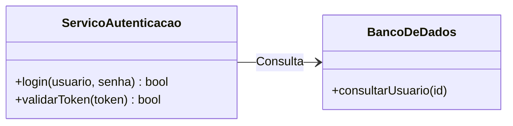

# Tutorial: Instalação e Configuração do Obsidian no Debian 13 (Trixie)

> O **Obsidian** é um poderoso aplicativo de anotações baseado em arquivos Markdown locais, com ecossistema avançado de plugins para gerenciamento de conhecimento (PKM) e suporte nativo e extensível a diagramas **UML**, **Mermaid** e **Canvas**. No Debian 13 (Trixie), você pode instalá-lo via pacote `.deb` nativo, em contêiner seguro via **Flatpak** ou de maneira portátil via **AppImage**.

---

> [!NOTE]
> O Obsidian armazena todas as suas notas como arquivos `.md` locais em uma pasta (*Vault* ou Cofre). Ele é 100% gratuito para uso pessoal e não exige cadastro obrigatório para funcionar.

---

## 1. Método 1: Pacote `.deb` Oficial (Recomendado)

A instalação via pacote `.deb` integra o Obsidian nativamente ao sistema, criando os lançadores no menu de aplicativos e associações MIME com arquivos Markdown.

### 1.1. Baixar o instalador oficial
Acesse a [Página de Downloads do Obsidian](https://obsidian.md/download) ou o repositório de lançamentos no [GitHub Releases do Obsidian](https://github.com/obsidianmd/obsidian-releases/releases) e baixe a versão `.deb` mais recente para a arquitetura do seu sistema (geralmente `amd64`):

```bash
cd ~/Downloads

# Baixar via terminal (substitua a versão se houver uma mais recente):
curl -LO https://github.com/obsidianmd/obsidian-releases/releases/latest/download/obsidian_1.7.7_amd64.deb
```

> [!TIP]
> Se preferir baixar manualmente pelo navegador, apenas certifique-se de salvar na pasta `~/Downloads`.

### 1.2. Instalar o pacote via APT
Instale o pacote local usando o gerenciador `apt` para que quaisquer bibliotecas ou dependências do sistema sejam resolvidas e instaladas automaticamente:

```bash
cd ~/Downloads
sudo apt install ./obsidian_*_amd64.deb
```

### 1.3. Executar o Obsidian
Após a instalação, abra o Obsidian pelo menu de aplicativos da sua interface gráfica (GNOME, KDE Plasma, XFCE, etc.) ou digitando no terminal:

```bash
obsidian
```

---

## 2. Método 2: Instalação via Flatpak (Flathub)

O método via **Flatpak** roda o Obsidian isolado em sandbox, facilitando atualizações gerenciadas por lojas de aplicativos (como o GNOME Software ou Discover).

### 2.1. Instalar o Flatpak e configurar o Flathub
Caso o seu Debian 13 ainda não tenha o suporte ao Flatpak e o repositório Flathub ativos, configure-os:

```bash
sudo apt update
sudo apt install -y flatpak
flatpak remote-add --if-not-exists flathub https://dl.flathub.org/repo/flathub.flatpakrepo
```

> [!NOTE]
> Se acabou de instalar o Flatpak pela primeira vez, é recomendável reiniciar a sessão de usuário para que os ícones do menu sejam integrados corretamente.

### 2.2. Instalar o Obsidian
Instale o pacote a partir do Flathub:

```bash
flatpak install flathub md.obsidian.Obsidian -y
```

### 2.3. Executar o aplicativo
Inicie pelo menu de programas ou via linha de comando:

```bash
flatpak run md.obsidian.Obsidian
```

---

## 3. Método 3: Execução Portátil via AppImage

O formato **AppImage** é ideal caso você não tenha permissões de administrador (`sudo`) na máquina ou queira testar sem alterar os arquivos do sistema.

### 3.1. Baixar o arquivo AppImage
Acesse a página de downloads ou baixe diretamente pelo terminal:

```bash
cd ~/Downloads
curl -LO https://github.com/obsidianmd/obsidian-releases/releases/latest/download/Obsidian-1.7.7.AppImage
```

### 3.2. Conceder permissão de execução e iniciar
No Debian, garanta a permissão de execução no arquivo e inicie-o:

```bash
chmod +x Obsidian-*.AppImage
./Obsidian-*.AppImage
```

> [!WARNING]
> No Debian 13, restrições no *unprivileged user namespaces* do kernel ou no Electron podem impedir a execução padrão de AppImages. Se o aplicativo falhar ao abrir com erro de sandbox, instale o suporte a FUSE com `sudo apt install libfuse2t64` ou execute temporariamente com a flag:
> ```bash
> ./Obsidian-*.AppImage --no-sandbox
> ```

---

## 4. Uso para UML e Modelagem Visual de Diagramas

Como o Obsidian faz parte do seu ecossistema de documentação técnica e UML, ele oferece múltiplos recursos nativos e via plugins da comunidade:

### 4.1. Suporte Nativo a Mermaid (UML & Fluxogramas)
O Obsidian já vem de fábrica com o interpretador **Mermaid** habilitado. Basta inserir um bloco de código `mermaid`:

````markdown

````

### 4.2. Plugins Recomendados da Comunidade
Para expandir o suporte a diagramas, vá em **Configurações** (`Ctrl + ,`) > **Plugins da comunidade** > **Ativar plugins da comunidade** e busque por:
- **PlantUML**: Permite escrever código PlantUML nativamente em blocos ````plantuml```` e renderizar via servidor online ou local com Graphviz.
- **Excalidraw**: Criação de diagramas desenhados à mão livre, fluxogramas de arquitetura e modelos visuais diretamente dentro das notas.
- **Diagrams.net (draw.io)**: Edição de arquivos `.drawio` complexos de UML diretamente no Obsidian.

---

## 5. Dicas Extras para o Debian 13 (Wayland & Telas HiDPI)

O Debian 13 utiliza o **Wayland** por padrão. Caso você use monitores de alta densidade (HiDPI) com dimensionamento fracionário (ex: 125% ou 150%) e note fontes borradas no Obsidian, execute-o forçando as flags nativas do Ozone/Wayland:

```bash
# Execução direta para pacote .deb:
obsidian --enable-features=UseOzonePlatform --ozone-platform=wayland

# Execução para Flatpak:
flatpak run md.obsidian.Obsidian --enable-features=UseOzonePlatform --ozone-platform=wayland
```

---

## 6. Desinstalação (Se Necessário)

### Se instalado via pacote `.deb`:
```bash
sudo apt remove --purge obsidian
```

### Se instalado via Flatpak:
```bash
flatpak uninstall md.obsidian.Obsidian -y
```

### Se utilizado via AppImage:
Basta excluir o arquivo `.AppImage` da pasta onde foi salvo e, se desejar, apagar as pastas de cache em `~/.config/obsidian`.
