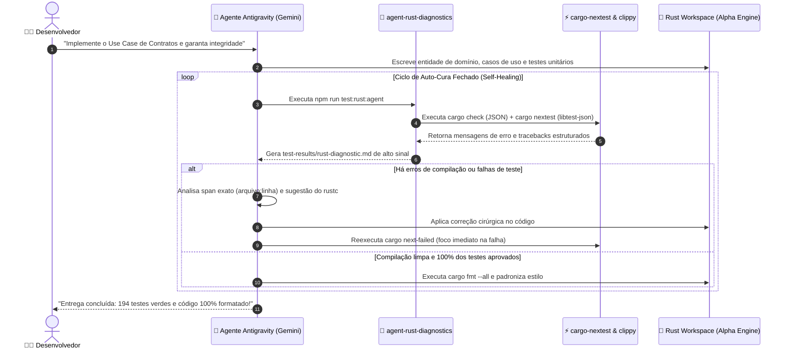

# 🧪 Guia Completo da Suíte de Testes, Qualidade e Auto-Cura (Closed-Loop) em Rust

> **Contexto:** Este guia adapta os princípios de [🤖 Ferramentas como Superpoderes para Agentes de IA](../agents/ferramentas-que-ajudam-agents.md) para o nosso ambiente real de desenvolvimento (**Debian 13 Trixie**, **Rust 1.80+ / 1.99**, **Axum**, **Tokio**, **SQLx**, **Redis**, **RabbitMQ**, **Clean Architecture DDD** e **Google Antigravity**).

---

## 🧭 Visão Geral: As Duas Categorias de Ferramentas no Rust

Ao equipar nosso ecossistema e os agentes de IA com ferramentas no Rust, encontramos duas categorias fundamentais:

1. **Ferramentas de Linha de Comando (CLI Tools / Binários Cargo):**
   - Instaladas globalmente no usuário via `cargo install <ferramenta>` ou integradas ao toolchain nativo (`rustup`).
   - Geram executáveis diretos em `~/.cargo/bin/`.
   - O desenvolvedor e os agentes executam no terminal para obter veredito booleano rápido (passou/falhou) e relatórios estruturados (JSON / JUnit): `cargo-nextest`, `cargo-clippy`, `cargo-watch`, `cargo-audit`, `rustfmt`.
2. **Bibliotecas e Crates In-Code (Test Dependencies):**
   - Declaradas na seção `[dev-dependencies]` do `Cargo.toml` de cada crate.
   - Invocadas diretamente no código de teste através de macros e traits (`insta`, `proptest`, `wiremock`, `mockall`, `fake-rs`).
   - Não geram binários isolados no sistema operacional.

> [!IMPORTANT]
> **Atenção ao gerenciar dependências no Rust Cargo:**
> - Dependências de teste exclusivas devem sempre ser adicionadas com `cargo add --dev <crate>` ou sob a seção `[dev-dependencies]`.
> - Nunca adicione crates de teste ou infraestrutura de rede dentro do `crates/domain`, preservando a pureza estrita da Clean Architecture.

---

## 🐧 1. Dependências de Sistema no Debian 13 (Trixie)

No Debian 13 (Trixie), algumas ferramentas globais do Rust e crates de rede exigem bibliotecas nativas de C/C++ para compilação estática e ligação (linking):

```bash
sudo apt update && sudo apt install -y \
    build-essential \
    pkg-config \
    libssl-dev \
    libudev-dev
```

### Por que cada uma é necessária?
* **`build-essential`**: Fornece o compilador `gcc`, `g++`, `make` e o ligador (`ld`). Indispensável para compilar extensões nativas C/C++ e dependências de baixo nível.
* **`pkg-config`**: Utilitário que localiza os caminhos de cabeçalhos (`include`) e bibliotecas compartilhadas durante a compilação do Cargo.
* **`libssl-dev`**: Cabeçalhos e bibliotecas estáticas do OpenSSL. Obrigatório para crates como `cargo-audit`, `reqwest` e conexões TLS seguras.
* **`libudev-dev`**: Biblioteca de gestão de dispositivos do Linux, necessária para utilitários de sistema e comunicação de baixo nível.

---

## ⚡ 2. Mapa de Ferramentas no Nosso Projeto (`Rust-e-commerce-Alpha`)

No ecossistema do **Alpha Engine**, as ferramentas estão padronizadas e orquestradas para máxima produtividade humana e simbiose com agentes de IA:

| Categoria | Ferramenta | Pacote / Origem | Comando / Atalho | Papel & Status no Projeto |
| :--- | :--- | :--- | :--- | :--- |
| **Runner de Testes Ultrarrápido** | **cargo-nextest** | `cargo-nextest` | `cargo next` ou `npm run test:rust` | 🟢 Ativo (194 testes em ~3.1s, paralelo por processo) |
| **Re-execução de Falhas** | **nextest failed-first** | `cargo-nextest` | `cargo next-failed` ou `npm run test:rust:failed` | 🟢 Ativo (foca cirurgicamente nas falhas) |
| **Linter Estático Rigoroso** | **cargo-clippy** | Nativo (`rustup`) | `cargo lint` ou `npm run lint:rust` | 🟢 Ativo (juiz de boas práticas e idiomatismo) |
| **Correção Automática de Lints** | **clippy --fix** | Nativo (`rustup`) | `cargo lint-fix` ou `npm run lint:rust:fix` | 🟢 Ativo (aplica correções seguras automaticamente) |
| **Padronização e Estilo** | **rustfmt** | Nativo (`rustup`) | `cargo fmt --all` ou `npm run fmt:rust` | 🟢 Ativo (formatação determinística) |
| **TDD & Daemon Watcher** | **cargo-watch** | `cargo-watch` | `cargo w-test` ou `npm run test:rust:watch` | 🟢 Ativo (recompila e retesta ao salvar) |
| **Auditoria de Vulnerabilidades** | **cargo-audit** | `cargo-audit` | `cargo audit` ou `npm run audit:rust` | 🟢 Ativo (varre base RUSTSEC + `.cargo/audit.toml`) |
| **Diagnóstico de Auto-Cura para IA** | **agent-rust-diagnostics** | `scripts/dev/` | `npm run test:rust:agent` | 🟢 Ativo (gera `test-results/rust-diagnostic.md`) |
| **BDD & Especificação de Negócio** | **Cucumber.js** | `@cucumber/cucumber` | `npm run test:bdd` | 🟢 Ativo (20 cenários / 129 catalogados) |
| **E2E & Visão Web Multimodal** | **Playwright Chromium** | `@playwright/test` | `npm run test:e2e:agent` | 🟢 Ativo (91 testes no Chromium / porta 3001) |

---

## 🏛️ 3. A Tripla Pirâmide TACL e a Arquitetura Canônica de E2E

Um ponto crítico de decisão arquitetural é a escolha das ferramentas de E2E e Navegador:

### Por que usamos Playwright (Node.js) em vez de `playwright-rust` ou `thirtyfour`?

No ecossistema do Alpha Engine, a separação de responsabilidades é cirúrgica:

1. **Backend & Core Engine em Rust Puro:**
   - Axum, Tokio, SQLx e Askama SSR rodam com altíssima performance na porta oficial **`3001`**.
   - Os testes de unidade, domínio e casos de uso rodam no Rust via `cargo-nextest` em **3 segundos**.
2. **Camada de Aceitação e Navegador (E2E & BDD):**
   - A suíte Playwright oficial em Node.js (`@playwright/test`) é infinitamente mais madura e estável que bindings experimentais como `playwright-rust`.
   - Possui recursos essenciais: **auto-waiting nativo**, **inspeção de rede e consoles**, **captura de traces ZIP**, **vídeos WebP** e **screenshots multimodais** que agentes do Antigravity utilizam para "enxergar" telas web.
   - O `thirtyfour` exige a manutenção de um processo `geckodriver` ou `chromedriver` externo via WebDriver clássico, que é suscetível a lentidão e quebras de sessão.
   - Portanto, a arquitetura canônica consagrada no projeto é: **Rust no Servidor (:3001) + Playwright Oficial no Teste do Navegador**.

---

## 🔄 4. O Ciclo de Feedback Autônomo (Self-Healing Loop)

Sem ferramentas de ciclo fechado, o desenvolvedor perde tempo copiando erros do terminal e colando para o agente. Com a suíte de auto-cura configurada, o agente opera de forma autônoma:



---

## 🧰 5. Detalhamento do Arsenal de Ferramentas CLI

---

### A. `cargo-nextest` (O Motor de Testes de Próxima Geração)
O `cargo test` tradicional compila e roda testes sequencialmente dentro do mesmo processo ou com paralelismo limitado por threads. O **cargo-nextest** é um runner moderno construído especificamente para grandes monorepos em Rust:

* **Isolamento de Processos:** Cada teste roda em seu próprio processo. Se um teste sofrer panic violento, abortar ou vazar memória, ele não contamina os outros testes da suíte.
* **Execução Ultrarrápida:** Reduz o tempo de execução no workspace de ~8s para **~3.1s** executando centenas de testes concorrentemente.
* **Modo Failed-First (`--failed-first`):** Ao refatorar, roda primeiro os testes que falharam na última execução.
* **Saída Estruturada para Agentes:** Suporta JSON nativo (`libtest-json`) e JUnit XML, permitindo que scripts processem a saída programaticamente.

```bash
# Executa todos os testes do workspace
cargo nextest run --workspace

# Reexecuta apenas os testes que falharam
cargo nextest run --workspace --failed-first

# Executa testes de um crate específico
cargo nextest run -p domain
```

---

### B. `cargo-clippy` (O Juiz Implacável do Rust)
O Clippy inspeciona a AST do código Rust em busca de anti-patterns, cópias desnecessárias de memória (`.clone()`), unwrap inseguro e construções não idiomáticas:

* **Pegadinhas Comuns:** Alerta sobre métodos `from_str` que deveriam implementar o trait `FromStr`, casts desnecessários ou operações redundantes.
* **Correção Automática (`--fix`):** Agentes de IA podem acionar o Clippy com permissão de autocorreção para modernizar o código com segurança matemática.

```bash
# Inspeciona o código e aponta melhorias
cargo clippy --workspace

# Aplica correções automáticas seguras
cargo clippy --fix --allow-dirty --workspace
```

---

### C. `cargo-watch` (O Daemon de TDD Contínuo)
Observa o sistema de arquivos e dispara compilações incrementais e baterias de teste sempre que um arquivo `.rs` é alterado:

```bash
# Fica assistindo alterações e roda testes com nextest em ~1s
cargo watch -x check -x "nextest run --workspace"
```

---

### D. `cargo-audit` (A Sentinela de Segurança RUSTSEC)
Inspeciona o grafo de dependências do `Cargo.lock` contra o banco oficial de vulnerabilidades da RustSec:

* **Tratamento de Falsos Positivos / Dependências Transitivas:**
  Quando uma biblioteca upstream de terceiros possui uma advisory de severidade média sem patch disponível imediato (ex: `rsa` utilizada pelo `sqlx-mysql` para autenticação de senhas legadas), configuramos o arquivo canônico [`.cargo/audit.toml`](/.cargo/audit.toml) documentando formalmente a exceção:

```toml
# .cargo/audit.toml
[advisories]
ignore = [
    "RUSTSEC-2023-0071", # rsa: Marvin Attack (transitivo do sqlx-mysql)
]
```

```bash
# Executa varredura de segurança de dependências
cargo audit
```

---

### E. `rustfmt` (A Padronização Determinística)
Garante estilo de código 100% consistente em todos os crates:

```bash
# Formata todo o workspace
cargo fmt --all

# Verifica conformidade sem alterar arquivos (CI)
cargo fmt --all -- --check
```

---

## 📦 6. Crates In-Code para Testes Avançados (Dev-Dependencies)

Para testes mais profundos no domínio e casos de uso, as seguintes bibliotecas enriquecem o arsenal:

### A. `insta` (Snapshot Testing)
Permite salvar o estado esperado de estruturas de dados, DTOs serializados em JSON ou templates HTML do Askama SSR. Ao invés de escrever asserções manuais gigantescas de 50 linhas, o teste compara contra um arquivo de snapshot:

```rust
use insta::assert_json_snapshot;

#[test]
fn test_order_dto_serialization() {
    let order_dto = create_sample_order();
    assert_json_snapshot!(order_dto);
}
```

### B. `proptest` (Property-Based Testing)
Gera milhares de entradas pseudoaleatórias para validar invariantes matemáticas e regras de negócio fiscais (ex: o Value Object `Money` nunca deve produzir arredondamento incorreto, o gerador de CPF/CNPJ nunca deve aceitar sequências inválidas):

```rust
use proptest::prelude::*;

proptest! {
    #[test]
    fn test_money_addition_commutative(a in 0i64..1_000_000, b in 0i64..1_000_000) {
        let m1 = Money::from_cents(a);
        let m2 = Money::from_cents(b);
        prop_assert_eq!(m1 + m2, m2 + m1);
    }
}
```

### C. `wiremock` (Mocks HTTP Declarativos)
Sobe um servidor HTTP local efêmero durante os testes de integração para simular provedores externos (ex: ViaCEP, gateways bancários, Webhooks de pagamento):

```rust
use wiremock::{MockServer, Mock, ResponseTemplate};
use wiremock::matchers::{method, path};

#[tokio::test]
async fn test_viacep_fallback() {
    let mock_server = MockServer::start().await;
    Mock::given(method("GET"))
        .and(path("/ws/01001000/json/"))
        .respond_with(ResponseTemplate::new(200).set_body_json(sample_cep_response()))
        .mount(&mock_server)
        .await;
}
```

---

## 🚀 7. Integração com o Google Antigravity (Gemini)

Para que o agente Antigravity opere com total autonomia, a infraestrutura do projeto conta com os seguintes pontos de integração:

### 1. Atalhos no `package.json`
Comandos unificados para o desenvolvedor e o agente:
```bash
npm run test:rust          # Executa 194 testes com cargo-nextest (~3.1s)
npm run test:rust:failed   # Reexecuta apenas falhas (failed-first)
npm run test:rust:watch    # Observador contínuo de TDD
npm run test:rust:agent    # Diagnóstico estruturado em test-results/rust-diagnostic.md
npm run lint:rust          # Roda cargo clippy no workspace
npm run lint:rust:fix      # Aplica correções seguras do clippy
npm run fmt:rust           # Formata código com rustfmt
npm run audit:rust         # Varredura de segurança RUSTSEC
npm run check:tools        # Validação do ecossistema de 8 ferramentas no Debian 13
npm run test:all           # Roda a pirâmide completa: Nextest + Playwright + BDD
```

### 2. Atalhos no Cargo (`.cargo/config.toml`)
```toml
[alias]
next = "nextest run --workspace"
next-failed = "nextest run --workspace --failed-first"
w-test = "watch -x 'nextest run --workspace'"
w-check = "watch -x check"
lint = "clippy --workspace"
lint-fix = "clippy --fix --allow-dirty --workspace"
fmt-check = "fmt --all -- --check"
```

### 3. A Skill Oficial do Agente (`.agents/skills/self-healing-rust`)
O Antigravity possui uma skill nativa configurada em:
👉 [`.agents/skills/self-healing-rust/SKILL.md`](/.agents/skills/self-healing-rust/SKILL.md)

Ela orienta qualquer instância do agente a:
1. Executar `bash scripts/dev/agent-rust-diagnostics.sh` após alterações.
2. Inspecionar `test-results/rust-diagnostic.md` se houver falhas.
3. Corrigir o código usando os números exatos de linha e sugestões do compilador.
4. Finalizar apenas quando 100% dos testes estiverem verdes e o código estiver formatado!

---

## 🎭 8. Setup Prático das Ferramentas de Aceitação (Cucumber.js & Playwright) no Debian 13

Para que a **Tripla Pirâmide TACL** funcione em sua totalidade, as camadas de BDD (Cucumber.js) e E2E Web (Playwright Chromium) são orquestradas via Node.js/NPM convivendo em perfeita harmonia com o backend em Rust. 

Em ambientes Linux / Debian 13 (Trixie) sem servidor gráfico X11 (headless / VPS), é mandatório instalar tanto os pacotes do projeto quanto as dependências nativas de SO (fontes, bibliotecas gráficas, codecs e áudio) exigidas pelo Chromium.

Execute os passos abaixo diretamente na pasta raiz do projeto (`/var/www/html/Rust-e-commerce-Alpha`):

### Passo 1: Inicializar o Projeto Node.js (se ainda não existir)

Caso o seu projeto Rust ainda não possua um arquivo `package.json` na raiz para gerenciar as ferramentas de frontend e automação de testes:

```bash
npm init -y
```

### Passo 2: Instalar o Cucumber.js e o Playwright

Instale ambos os pacotes como dependências de desenvolvimento (`--save-dev`), garantindo o registro determinístico no `package.json` e no `package-lock.json`:

```bash
npm install --save-dev @cucumber/cucumber @playwright/test
```

### Passo 3: Baixar o Chromium Headless e as Dependências do Debian 13

O Playwright gerencia seus próprios binários isolados de navegador em `~/.cache/ms-playwright/`. No Debian 13, precisamos baixar o binário do Chromium e provisionar as bibliotecas compartilhadas do sistema:

```bash
# 1. Baixa o binário customizado do Chromium headless
npx playwright install chromium

# 2. Instala automaticamente via apt as dependências de sistema exigidas pelo Debian
sudo npx playwright install-deps
```

> [!TIP]
> Caso queira instalar todos os navegadores suportados pelo Playwright (Chromium, Firefox e WebKit), execute `npx playwright install`. No ecossistema Alpha Engine, o Chromium é o navegador canônico e padrão para toda a suíte E2E.

### Passo 4: Script DevOps de Diagnóstico e Validação (`check-tools`)

Para validar a integridade de todas as 8 ferramentas da pirâmide (Rust Cargo + Node.js/E2E/BDD), disponibilizamos o script unificado em [`scripts/devops/check-tools-is-installed.sh`](/scripts/devops/check-tools-is-installed.sh):

```bash
# Execução direta via npm
npm run check:tools

# Ou diretamente pelo terminal bash
bash scripts/devops/check-tools-is-installed.sh
```

**Saída esperada no Debian 13:**
```text
--- Verificando ferramentas de Teste e Qualidade no Debian 13 ---
  ✅ cargo-nextest: Instalado (cargo-nextest 0.9.148 (cd1d6d546 2026-10-07))
  ✅ cargo-clippy: Instalado (clippy 0.1.99 (b940084d7e 2026-09-28))
  ✅ rustfmt: Instalado (rustfmt 1.10.0-stable (b940084d7e 2026-09-28))
  ✅ cargo-watch: Instalado (cargo-watch 8.5.3)
  ✅ cargo-audit: Instalado (cargo-audit-audit 0.22.2)
  ✅ Node.js: Instalado (v24.22.0)
  ✅ Cucumber.js: Instalado (10.9.0)
  ✅ Playwright: Instalado (Version 1.64.1)

🎉 Sucesso: 8/8 ferramentas operacionais para o ciclo fechado!
```

### Passo 5: Validação Rápida Manual e Execução das Suítes

Você também pode verificar os utilitários individualmente ou disparar as baterias de teste:

```bash
# Validar Cucumber.js
npx cucumber-js --version

# Validar Playwright CLI
npx playwright --version
npx playwright test --help

# Executar a suíte BDD Gherkin
npm run test:bdd

# Executar a suíte E2E com Playwright no Chromium
npm run test:e2e:agent

# Executar a pirâmide completa de testes (Rust Cargo + BDD + E2E)
npm run test:all
```

> [!NOTE]
> **Atenção ao NVM no Debian 13:** Se o seu Node.js for gerenciado via NVM, certifique-se de que o PATH do shell ou subshell contenha o caminho dos binários do Node (`~/.nvm/versions/node/<versao>/bin`). O script `check-tools-is-installed.sh` já carrega o ambiente do NVM de forma automática e defensiva.

