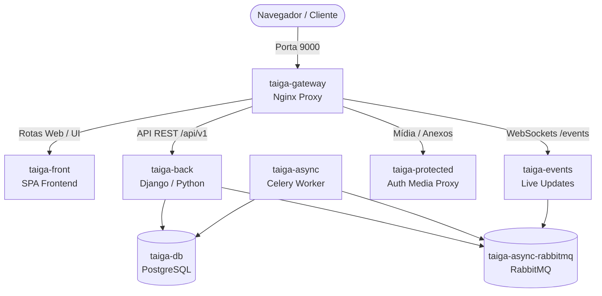

# Instalação e Configuração do Taiga com Docker no Debian 13

Guia passo a passo para instalar e executar o **Taiga** (plataforma de gerenciamento de projetos ágeis, Kanban e Scrum) utilizando o **Docker Compose** oficial no **Debian 13 (Trixie)**.

O Taiga possui uma arquitetura robusta e distribuída em microserviços (backend Django, frontend SPA, WebSocket de eventos em tempo real, broker de mensagens RabbitMQ, workers assíncronos Celery, proxy Nginx e banco de dados PostgreSQL). A forma recomendada e mantida pela equipe oficial do Taiga para hospedar a aplicação é através do repositório oficial [`taiga-docker`](https://github.com/taigaio/taiga-docker).

---

## Arquitetura da Stack Taiga

Ao iniciar a stack oficial, o Docker Compose orquestra os seguintes serviços integrados:



### Componentes da Stack

- **`taiga-gateway`**: Servidor Nginx que atua como porta de entrada única (*reverse proxy*) na porta `9000`, direcionando requisições para o frontend, backend e websockets.
- **`taiga-front`**: Servidor Nginx que entrega a interface SPA (*Single Page Application*) em HTML5/JavaScript.
- **`taiga-back`**: A API principal do Taiga, desenvolvida em Python com o framework Django.
- **`taiga-events`**: Servidor WebSocket baseado em Node.js para atualizações em tempo real nos quadros Kanban e tarefas sem necessidade de recarregar a página.
- **`taiga-async-rabbitmq`**: Broker de mensagens RabbitMQ para enfileirar tarefas assíncronas.
- **`taiga-async`**: Worker Celery para processamento de tarefas em segundo plano (como envio de e-mails, webhooks e notificações).
- **`taiga-protected`**: Proxy de proteção e autenticação para download de anexos privados e uploads de mídia.
- **`taiga-db`**: Banco de dados relacional PostgreSQL dedicado exclusivamente para a aplicação com persistência em volumes Docker.

---

## Pré-requisitos

Antes de iniciar, certifique-se de que seu sistema Debian 13 atende aos seguintes requisitos:

1. **Docker Engine e Docker Compose** instalados e funcionando:
   ```bash
   docker --version
   docker compose version
   ```
   > [!TIP]
   > Certifique-se de que seu usuário pertence ao grupo `docker` para executar comandos sem `sudo`:
   > ```bash
   > sudo usermod -aG docker $USER
   > newgrp docker
   > ```

2. **Git** instalado para clonar o repositório oficial:
   ```bash
   git --version
   ```
   *Caso não esteja instalado: `sudo apt update && sudo apt install -y git`.*

3. **Porta 9000 livre** no sistema para a interface web (ou você poderá alterar para outra porta no arquivo `.env`).

---

## Passo a Passo para Subir o Taiga no Debian 13

### 1. Clonar o Repositório Oficial do Taiga Docker

Escolha um diretório adequado para os arquivos da aplicação (por exemplo, na sua pasta de projetos `~/taiga` ou outro diretório de sua preferência):

```bash
# 1. Clone o repositório oficial
git clone https://github.com/taigaio/taiga-docker.git

# 2. Acesse a pasta do projeto
cd taiga-docker

# 3. Mude para a branch estável recomendada para produção
git checkout stable
```

---

### 2. Configurar as Variáveis de Ambiente (`.env`)

O Taiga necessita de um arquivo de configuração `.env` contendo as chaves de criptografia, credenciais do banco de dados e as URLs de acesso.

O repositório disponibiliza um script automatizado que cria o `.env` com senhas aleatórias e seguras:

```bash
./launch-taiga.sh
```

> [!NOTE]
> Na primeira execução, o script `./launch-taiga.sh` gera o arquivo `.env` automaticamente e tenta iniciar os contêineres em primeiro plano. Você pode aguardar alguns instantes e pressionar `Ctrl + C` para pará-lo e rodar em segundo plano (*detached mode*).

#### Ajustes manuais no arquivo `.env` (Opcional)

Se desejar personalizar a URL de acesso (por exemplo, utilizando o IP da máquina na rede local ou um domínio), edite o arquivo `.env`:

```bash
nano .env
```

Verifique e ajuste as seguintes variáveis conforme seu cenário:

```dotenv
# Protocolo e domínio/IP de acesso
TAIGA_SCHEME=http
TAIGA_DOMAIN=localhost:9000

# URLs geradas automaticamente a partir do schema e domínio
TAIGA_URL=http://localhost:9000
TAIGA_WEBSOCKETS_URL=ws://localhost:9000

# Porta do host mapeada para o gateway (padrão: 9000)
TAIGA_GATEWAY_PORT=9000

# Chave secreta da aplicação (já gerada aleatoriamente pelo script)
# SECRET_KEY="sua-chave-secreta-aqui"
```

*Para salvar e sair do `nano`: pressione `Ctrl + O`, tecle `Enter` e depois `Ctrl + X`.*

---

### 3. Inicializar a Infraestrutura em Segundo Plano

Com o arquivo `.env` configurado, inicialize todos os contêineres em segundo plano (*detached mode*):

```bash
docker compose up -d
```

#### Verificar se todos os contêineres estão ativos:

```bash
docker compose ps
```

Todos os serviços (`taiga-gateway`, `taiga-front`, `taiga-back`, `taiga-events`, `taiga-async`, `taiga-async-rabbitmq`, `taiga-protected`, `taiga-db`) devem constar com status `running` ou `healthy`.

> [!IMPORTANT]
> Na primeira inicialização, o contêiner `taiga-back` executa automaticamente as migrações do banco de dados no PostgreSQL. Isso pode levar cerca de 1 a 2 minutos. Você pode acompanhar o progresso com:
> ```bash
> docker compose logs -f taiga-back
> ```
> Pressione `Ctrl + C` para sair do modo de visualização de logs.

---

### 4. Criar o Usuário Administrador (Superusuário)

Com os contêineres em execução, você precisa criar uma conta de superusuário para realizar o primeiro login no painel de administração e na plataforma:

Execute o utilitário de gerenciamento oficial incluído no repositório:

```bash
./taiga-manage.sh createsuperuser
```

> [!TIP]
> Caso prefira chamar o comando diretamente via Docker Compose sem utilizar o script facilitador:
> ```bash
> docker compose exec taiga-back python manage.py createsuperuser
> ```

Siga as instruções interativas no terminal:
- **Username:** `admin` (ou o nome de sua preferência)
- **Email address:** `seu-email@dominio.com`
- **Password:** digite uma senha segura
- **Password (again):** confirme a senha

---

### 5. Acessar a Aplicação e Primeiros Passos

1. Abra o navegador web de sua preferência.
2. Acesse o endereço configurado:
   ```
   http://localhost:9000
   ```
   *(Ou `http://IP_DO_SERVIDOR:9000` caso esteja acessando de outro computador na rede local).*
3. Clique em **Login** no canto superior direito e utilize o usuário e a senha cadastrados no passo 4.
4. Ao entrar, você já pode:
   - Criar um novo projeto selecionando o modelo **Kanban** ou **Scrum**.
   - Definir papéis e permissões da equipe.
   - Configurar colunas de fluxo de valor, raias (*swimlanes*) e limites WIP (*Work In Progress*).
   - Gerenciar Backlog, Épicos, Sprints e Wiki integrada.

---

## Comandos Úteis de Gerenciamento

Guarde estes comandos para o dia a dia de manutenção da sua instância do Taiga:

### Iniciar e Parar a Stack

- **Parar todos os contêineres (sem perder dados):**
  ```bash
  docker compose stop
  ```

- **Iniciar os contêineres previamente parados:**
  ```bash
  docker compose start
  ```

- **Reiniciar todos os serviços:**
  ```bash
  docker compose restart
  ```

- **Derrubar a stack (mantendo os volumes de dados preservados):**
  ```bash
  docker compose down
  ```

### Monitorar Logs em Tempo Real

- **Logs de todos os serviços combinados:**
  ```bash
  docker compose logs -f --tail=100
  ```

- **Logs de um serviço específico (ex: backend ou gateway):**
  ```bash
  docker compose logs -f taiga-back
  docker compose logs -f taiga-gateway
  ```

### Backup do Banco de Dados PostgreSQL

Para gerar um dump de backup seguro do banco de dados:

```bash
docker compose exec -T taiga-db pg_dump -U taiga taiga > backup_taiga_$(date +%Y%m%d_%H%M%S).sql
```

### Restaurar o Banco de Dados a partir de um Backup

```bash
cat seu_backup.sql | docker compose exec -T taiga-db psql -U taiga taiga
```

---

## Resolução de Problemas (Troubleshooting)

### 1. Erro de permissão ao executar o Docker (`permission denied`)
Se receber a mensagem `Got permission denied while trying to connect to the Docker daemon socket`:
```bash
sudo usermod -aG docker $USER
newgrp docker
```
Depois tente rodar `docker ps` novamente.

### 2. A porta 9000 já está em uso por outro serviço
Se outro serviço (como Portainer, SonarQube ou outro container) já estiver utilizando a porta 9000:
1. Abra o arquivo `.env`:
   ```bash
   nano .env
   ```
2. Altere `TAIGA_GATEWAY_PORT` para outra porta livre (por exemplo `9090`):
   ```dotenv
   TAIGA_GATEWAY_PORT=9090
   TAIGA_DOMAIN=localhost:9090
   TAIGA_URL=http://localhost:9090
   TAIGA_WEBSOCKETS_URL=ws://localhost:9090
   ```
3. Reinicie a stack para aplicar as novas configurações:
   ```bash
   docker compose up -d --force-recreate
   ```

### 3. Os quadros Kanban não atualizam em tempo real (WebSockets)
Se as movimentações de cartões não refletirem instantaneamente entre diferentes janelas:
1. Verifique se o contêiner `taiga-events` e o `taiga-async-rabbitmq` estão ativos:
   ```bash
   docker compose ps taiga-events taiga-async-rabbitmq
   ```
2. Inspecione os logs do serviço de eventos:
   ```bash
   docker compose logs -f taiga-events
   ```
3. Certifique-se de que no arquivo `.env` a variável `TAIGA_WEBSOCKETS_URL` aponta exatamente para o mesmo protocolo e porta que você usa no navegador (`ws://localhost:9000` para HTTP ou `wss://dominio.com/events` para HTTPS com SSL).

### 4. Reinicialização limpa da base de dados (CUIDADO: apaga dados)
Se a instalação for interrompida no meio e você quiser recomeçar do zero:
```bash
# Para a stack e remove contêineres e volumes de dados
docker compose down -v

# Sobe novamente recriando os volumes limpos
docker compose up -d
```
