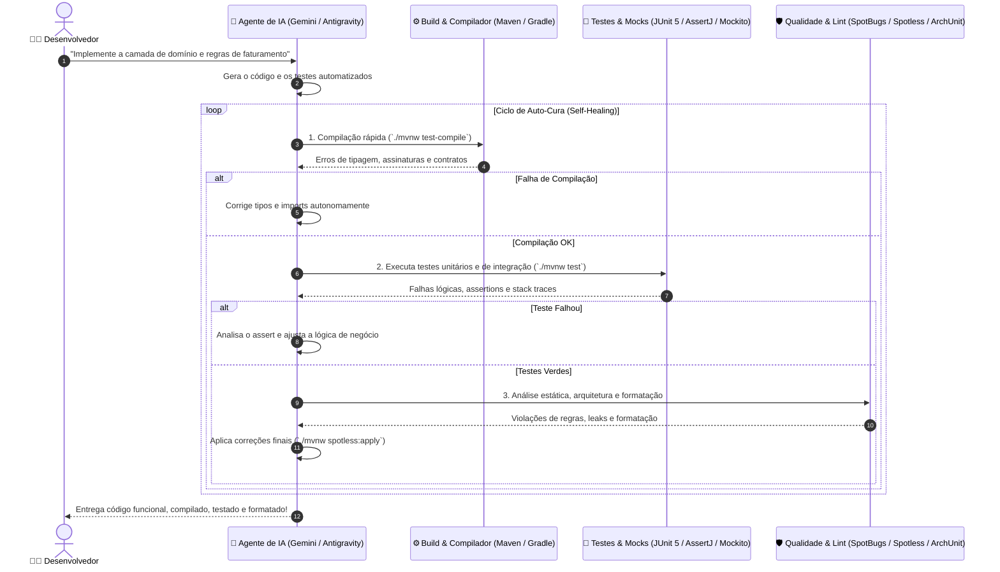

* **FATEC-FV Faculdade de Tecnologia de Ferraz de Vasconcelos**
* **ADS - Análise e Desenvolvimento de Sistemas**
* **Teste de Software**
* **Professor:** Alexander Bastos
* **Aluno:** Josias Sobrinho

# 🧪 Guia Completo da Suíte de Testes, Qualidade e Ferramentas para Agentes em Java

> **Contexto:** Este guia complementa os tutoriais [🤖 Ferramentas como Superpoderes para Agentes de IA](../agents/ferramentas-que-ajudam-agents.md) e [☕ Configuração do Java](java.md), adaptando os conceitos de **Ciclo Fechado** e **Auto-Cura (*Self-Healing Code*)** para o ecossistema **Java 21+ (LTS)** em ambiente **Debian 13** com **Maven / Gradle** e **Google Antigravity**.

---

## 🧭 Visão Geral: O Ciclo Fechado no Ecossistema Java

Diferente de linguagens dinâmicas onde erros de digitação e tipos só explodem em tempo de execução, o Java oferece uma camada inicial nativa e rigorosa: o **compilador (`javac`)**.

No entanto, para que um **Agente de IA (como o Google Gemini no Antigravity)** trabalhe com **auto-cura de ponta a ponta**, apenas compilar não basta. O agente necessita de um ciclo automatizado de ferramentas com **feedback determinístico e binário (passou / falhou)**:



---

## 🧱 Dois Tipos de Ferramentas no Java: Plugins vs Dependências

No ecossistema Java, as ferramentas não são executáveis isolados em uma pasta `bin` como no PHP ou Node. Elas se dividem em:

1. **Plugins de Build (Maven Plugins / Gradle Plugins):**
   - Configurados nas tags `<plugins>` do `pom.xml` ou `plugins { ... }` do `build.gradle`.
   - Executados diretamente pela CLI via wrappers (`./mvnw <plugin>:<goal>` ou `./gradlew <task>`).
   - Exemplos: `spotless`, `spotbugs`, `checkstyle`, `jacoco`, `pitest`.
2. **Dependências e Bibliotecas de Teste/Código (In-Code Libraries):**
   - Inseridas com escopo `<scope>test</scope>` (Maven) ou `testImplementation` (Gradle).
   - Invocadas via anotações e código Java (`@Test`, `assertThat()`, `Mockito.when()`, `ArchRule`).
   - Exemplos: `JUnit 5 (Jupiter)`, `AssertJ`, `Mockito`, `ArchUnit`, `Testcontainers`.

> [!TIP]
> **Sempre utilize os wrappers (`./mvnw` ou `./gradlew`)**:
> Eles garantem que os agentes executem a versão idêntica do Maven/Gradle sem depender de instalações globais do sistema operacional.

---

## ⚡ Mapa de Ferramentas Recomendadas para Java

| Categoria | Ferramenta | Dependência / Plugin | Comando de Execução | Papel na Auto-Cura |
| :--- | :--- | :--- | :--- | :--- |
| **Compilação Rápida** | **Javac / Compiler Plugin** | `maven-compiler-plugin` | `./mvnw test-compile` | Valida sintaxe, tipos estritos e contratos antes de rodar testes |
| **Testes Unitários & TDD** | **JUnit 5 (Jupiter)** | `org.junit.jupiter:junit-jupiter` | `./mvnw test` | Motor principal do feedback verde/vermelho (*Red-Green-Refactor*) |
| **Fluent Assertions** | **AssertJ** | `org.assertj:assertj-core` | In-code (`assertThat(...)`) | Mensagens de erro extremamente descritivas para o LLM interpretar |
| **Mocks e Dublês** | **Mockito** | `org.mockito:mockito-junit-jupiter` | In-code (`@ExtendWith(MockitoExtension.class)`) | Isola dependências externas (bancos, APIs, mensageria) |
| **Formatador Automático** | **Spotless (Google Java Format)** | `spotless-maven-plugin` | `./mvnw spotless:apply` | **Auto-cura imediata:** Formata o código sem intervenção humana |
| **Análise Estática de Bugs** | **SpotBugs** | `spotbugs-maven-plugin` | `./mvnw spotbugs:check` | Detecta NPEs, concorrência falha e recursos não fechados |
| **Regras Arquiteturais** | **ArchUnit** | `com.tngtech.archunit:archunit-junit5` | Roda via JUnit 5 | Impede que o agente viole camadas (ex: Controller acessando DB) |
| **Testes de Integração Real** | **Testcontainers** | `org.testcontainers:junit-jupiter` | Roda via JUnit 5 | Sobe containers reais (Postgres, Redis, Kafka) em testes |
| **Cobertura de Código** | **JaCoCo** | `jacoco-maven-plugin` | `./mvnw jacoco:report` | Aponta branches e métodos não cobertos |
| **Testes de Mutação** | **Pitest (PIT)** | `pitest-maven` | `./mvnw pitest:mutationCoverage` | Garante que os testes do agente realmente detectem defeitos |
| **E2E & Visão Web** | **Playwright Java** | `com.microsoft.playwright:playwright` | Teste JUnit 5 ou CLI | Agente navega e inspeciona interfaces frontend |
| **Agentes & LLMs no Java** | **LangChain4j / Spring AI** | `dev.langchain4j` / `spring-ai` | Dependências de aplicação | Construção de agentes autônomos, RAG e chamadas de ferramentas |

---

## 🚀 Comandos Rápidos de Linha de Comando (CLI)

Padronize estes comandos para que você e os agentes de IA possam acioná-los com uma única instrução:

### Para Projetos Maven:
```bash
# 1. Compilação rápida de código e testes (sem rodar os testes)
./mvnw test-compile

# 2. Executa toda a suíte de testes unitários
./mvnw test

# 3. Executa apenas uma classe de teste específica
./mvnw test -Dtest=OrderServiceTest

# 4. Executa apenas um método de teste específico
./mvnw test -Dtest=OrderServiceTest#shouldCalculateDiscount

# 5. Formatação automática de código (Spotless)
./mvnw spotless:apply

# 6. Verificação de estilo sem alterar arquivos
./mvnw spotless:check

# 7. Análise estática de bugs (SpotBugs)
./mvnw spotbugs:check

# 8. Validação completa do ciclo de vida (compila, testa, empacota e valida)
./mvnw verify
```

### Para Projetos Gradle:
```bash
# 1. Compilação rápida
./gradlew compileTestJava

# 2. Executa todos os testes
./gradlew test

# 3. Executa apenas um teste específico
./gradlew test --tests "com.example.OrderServiceTest"

# 4. Formata código automaticamente com Spotless
./gradlew spotlessApply

# 5. Análise de qualidade e verificação geral
./gradlew check
```

---

## 🧰 Detalhamento por Categoria

---

### 1. Compilação e Verificação Rápida de Tipos

No fluxo com agentes, a compilação de testes é o primeiro filtro. Se o agente alterar uma interface ou método e esquecer de atualizar as chamadas, `./mvnw test-compile` falha em milissegundos com a linha e coluna exatas do erro.

```xml
<!-- pom.xml: Compilador moderno com suporte a Java 21 -->
<plugin>
    <groupId>org.apache.maven.plugins</groupId>
    <artifactId>maven-compiler-plugin</artifactId>
    <version>3.13.0</version>
    <configuration>
        <source>21</source>
        <target>21</target>
        <compilerArgs>
            <arg>-parameters</arg>
        </compilerArgs>
    </configuration>
</plugin>
```

---

### 2. Testes Automatizados e TDD (JUnit 5 + AssertJ + Mockito)

Essa tríade compõe o alicerce para TDD autônomo com agentes.

#### Configuração das Dependências no `pom.xml`:
```xml
<dependencies>
    <!-- JUnit 5 (Jupiter Engine & API) -->
    <dependency>
        <groupId>org.junit.jupiter</groupId>
        <artifactId>junit-jupiter</artifactId>
        <version>5.10.2</version>
        <scope>test</scope>
    </dependency>

    <!-- AssertJ: Assertions fluentes e legíveis -->
    <dependency>
        <groupId>org.assertj</groupId>
        <artifactId>assertj-core</artifactId>
        <version>3.25.3</version>
        <scope>test</scope>
    </dependency>

    <!-- Mockito: Dublês e simulações com integração ao JUnit 5 -->
    <dependency>
        <groupId>org.mockito</groupId>
        <artifactId>mockito-junit-jupiter</artifactId>
        <version>5.11.0</version>
        <scope>test</scope>
    </dependency>
</dependencies>
```

#### Exemplo de Teste Fluente Ideal para Agentes:
```java
package com.empresa.faturamento;

import org.junit.jupiter.api.DisplayName;
import org.junit.jupiter.api.Test;
import org.junit.jupiter.api.extension.ExtendWith;
import org.mockito.InjectMocks;
import org.mockito.Mock;
import org.mockito.junit.jupiter.MockitoExtension;

import java.math.BigDecimal;
import java.util.Optional;

import static org.assertj.core.api.Assertions.assertThat;
import static org.assertj.core.api.Assertions.assertThatThrownBy;
import static org.mockito.Mockito.verify;
import static org.mockito.Mockito.when;

@ExtendWith(MockitoExtension.class)
class ProcessadorPagamentoTest {

    @Mock
    private GatewayPagamento gateway;

    @Mock
    private PedidoRepository repository;

    @InjectMocks
    private ProcessadorPagamento processador;

    @Test
    @DisplayName("Deve autorizar pagamento e atualizar status do pedido para PAGO")
    void deveAutorizarPagamentoComSucesso() {
        // Dado
        Pedido pedido = new Pedido("PED-123", new BigDecimal("150.00"));
        when(repository.buscarPorId("PED-123")).thenReturn(Optional.of(pedido));
        when(gateway.cobrar(new BigDecimal("150.00"))).thenReturn(new TransacaoSucesso("TXN-999"));

        // Quando
        ResultadoPagamento resultado = processador.processar("PED-123");

        // Então
        assertThat(resultado.isSucesso()).isTrue();
        assertThat(pedido.getStatus()).isEqualTo(StatusPedido.PAGO);
        verify(repository).salvar(pedido);
    }
}
```

> [!NOTE]
> **Por que usar AssertJ?**  
> Quando uma asserção falha, o AssertJ gera um diff legível:  
> `expected: StatusPedido.PAGO but was: StatusPedido.PENDENTE`.  
> Isso permite que o LLM identifique instantaneamente a discrepância lógica sem ambiguidades.

---

### 3. Formatadores e Linters Automáticos (Spotless)

O **Spotless** é uma das ferramentas mais importantes para agentes de IA no Java, porque ele possui capacidade de **auto-correção instantânea (`apply`)**.

Em vez de repreender o agente por espaçamento, quebra de linha ou ordem de imports, basta instruir o agente a rodar `./mvnw spotless:apply`.

#### Configuração do Spotless no `pom.xml` (com Google Java Format):
```xml
<plugin>
    <groupId>com.diffplug.spotless</groupId>
    <artifactId>spotless-maven-plugin</artifactId>
    <version>2.43.0</version>
    <configuration>
        <java>
            <googleJavaFormat>
                <version>1.22.0</version>
                <style>GOOGLE</style>
            </googleJavaFormat>
            <removeUnusedImports />
            <trimTrailingWhitespace />
            <endWithNewline />
        </java>
    </configuration>
</plugin>
```

- **Para o agente formatar tudo autonomamente:**
  ```bash
  ./mvnw spotless:apply
  ```
- **Para validar no CI / portão de qualidade:**
  ```bash
  ./mvnw spotless:check
  ```

---

### 4. Análise Estática de Código (SpotBugs & Checkstyle)

#### A. SpotBugs (O caçador de bugs silenciosos)
Detecta problemas como: `NullPointerException` em potencial, vazamento de conexões ou streams de I/O não fechadas, vulnerabilidades e concorrência insegura.

```xml
<plugin>
    <groupId>com.github.spotbugs</groupId>
    <artifactId>spotbugs-maven-plugin</artifactId>
    <version>4.8.4.0</version>
    <configuration>
        <effort>Max</effort>
        <threshold>Medium</threshold>
        <failOnError>true</failOnError>
    </configuration>
</plugin>
```

- **Execução:**
  ```bash
  ./mvnw spotbugs:check
  ```

#### B. Checkstyle
Valida regras estritas de convenção de código (nomes de métodos, visibilidade, Javadoc obrigatório se desejado).

- **Execução:**
  ```bash
  ./mvnw checkstyle:check
  ```

---

### 5. Integridade Arquitetural (ArchUnit)

Modelos de IA podem facilmente violar limites arquiteturais (por exemplo, injetar um repositório JPA diretamente em um Controller ou acessar classes de infraestrutura dentro de entidades puras de domínio).

O **ArchUnit** permite escrever testes unitários em Java que validam a arquitetura:

```xml
<dependency>
    <groupId>com.tngtech.archunit</groupId>
    <artifactId>archunit-junit5</artifactId>
    <version>1.3.0</version>
    <scope>test</scope>
</dependency>
```

#### Exemplo de Regra Arquitetural como Teste:
```java
package com.empresa.arquitetura;

import com.tngtech.archunit.junit.AnalyzeClasses;
import com.tngtech.archunit.junit.ArchTest;
import com.tngtech.archunit.lang.ArchRule;

import static com.tngtech.archunit.lang.syntax.ArchRuleDefinition.classes;
import static com.tngtech.archunit.library.Architectures.layeredArchitecture;

@AnalyzeClasses(packages = "com.empresa")
class ArquiteturaTest {

    @ArchTest
    static final ArchRule dominioNaoDeveDependerDeInfra =
        classes().that().resideInAPackage("..domain..")
                 .should().onlyDependOnClassesThat()
                 .resideInAnyPackage("..domain..", "java..");

    @ArchTest
    static final ArchRule camadasHexagonaisDevemSerRespeitadas =
        layeredArchitecture()
            .consideringAllDependencies()
            .layer("Dominio").definedBy("..domain..")
            .layer("Aplicacao").definedBy("..application..")
            .layer("Infra").definedBy("..infrastructure..")
            .whereLayer("Dominio").mayOnlyBeAccessedByLayers("Aplicacao", "Infra")
            .whereLayer("Aplicacao").mayOnlyBeAccessedByLayers("Infra");
}
```

> [!IMPORTANT]
> Se o agente tentar contornar a Clean Architecture, o comando `./mvnw test` falhará imediatamente informando qual classe violou a fronteira de camada.

---

### 6. Testes de Integração Realistas (Testcontainers)

Agentes frequentemente escrevem testes usando bancos H2 em memória com sintaxes que depois falham no PostgreSQL real. O **Testcontainers** resolve isso subindo instâncias reais de containers Docker descartáveis controladas diretamente pelo JUnit 5.

```xml
<dependency>
    <groupId>org.testcontainers</groupId>
    <artifactId>postgresql</artifactId>
    <version>1.19.7</version>
    <scope>test</scope>
</dependency>
<dependency>
    <groupId>org.testcontainers</groupId>
    <artifactId>junit-jupiter</artifactId>
    <version>1.19.7</version>
    <scope>test</scope>
</dependency>
```

---

### 7. Navegação Headless e E2E (Playwright para Java)

Assim como no ecossistema PHP/Node, você pode usar o Playwright diretamente em Java para testes ponta a ponta e fornecer visão web ao agente:

```xml
<dependency>
    <groupId>com.microsoft.playwright</groupId>
    <artifactId>playwright</artifactId>
    <version>1.43.0</version>
    <scope>test</scope>
</dependency>
```

```java
import com.microsoft.playwright.*;
import org.junit.jupiter.api.Test;

class LoginE2ETest {
    @Test
    void deveFazerLoginComSucesso() {
        try (Playwright playwright = Playwright.create()) {
            Browser browser = playwright.chromium().launch();
            Page page = browser.newPage();
            page.navigate("http://localhost:8080/login");
            page.fill("#email", "admin@empresa.com");
            page.fill("#senha", "Segredo123");
            page.click("#btn-entrar");
            
            org.assertj.core.api.Assertions.assertThat(page.title()).contains("Dashboard");
        }
    }
}
```

---

### 8. Bibliotecas para Criação de Agentes de IA em Java

Se você estiver desenvolvendo agentes ou recursos de IA Generativa dentro da própria aplicação Java:

#### A. LangChain4j (O framework de referência para IA em Java)
- **Artefato:** `dev.langchain4j:langchain4j`
- **Uso:** Orquestração de LLMs (Gemini, OpenAI, Claude, Ollama), ferramentas (*Tool / Function Calling*), memória de conversação e fluxos RAG em Java puro ou Spring Boot / Quarkus.

#### B. Spring AI
- **Artefato:** `org.springframework.ai:spring-ai-bom`
- **Uso:** Framework oficial do ecossistema Spring para integração nativa com modelos de linguagem, vetores e observabilidade.

---

## 🤖 Como Instruir os Agentes de IA a Usar a Suíte no Java

Para habilitar o comportamento de auto-cura (*Self-Healing Loop*), inclua as diretrizes abaixo nas instruções de projeto (`GEMINI.md`, `AGENTS.md` ou no prompt do workspace):

```markdown
### 🛠️ Protocolo de Qualidade e Auto-Cura Obrigatório para o Agente Java

Sempre que criar ou refatorar código Java, você deve seguir este fluxo autônomo e iterativo:

1. **Validação Rápida de Compilação:**
   - Execute `./mvnw test-compile` (ou `./gradlew compileTestJava`).
   - Se houver erros de tipo, imports faltantes ou incompatibilidades de método, corrija-os antes de rodar os testes.

2. **Ciclo TDD e Verificação Funcional:**
   - Crie ou adapte os testes com JUnit 5 e AssertJ em `src/test/java`.
   - Execute a suíte focada na alteração: `./mvnw test -Dtest=NomeDaClasseTest`.
   - Se houver asserções quebradas, analise o motivo lógico e ajuste a implementação (nunca remova testes sem justificativa explícita).

3. **Verificação Arquitetural e Análise Estática:**
   - Garanta que testes de arquitetura com ArchUnit passem.
   - Execute `./mvnw spotbugs:check` para assegurar que não haja bugs estáticos (leaks, NPEs potenciais).

4. **Auto-Correção e Formatação Obrigatória:**
   - Antes de entregar a resposta final, execute: `./mvnw spotless:apply` (ou `./gradlew spotlessApply`).
   - Isso garante conformidade imediata com as diretrizes do projeto (Google Java Format).
```

---

## 📊 Comparativo Direto: PHP vs Java

Para desenvolvedores migrando ou trabalhando em ambos os ecossistemas:

| Finalidade | PHP (agsonhos2) | Java (OpenJDK 21) |
| :--- | :--- | :--- |
| **Gerenciador de Dependências** | `Composer` (`composer.json`) | `Maven` (`pom.xml`) ou `Gradle` (`build.gradle`) |
| **Executáveis CLI** | `./vendor/bin/*` | Wrappers (`./mvnw` / `./gradlew`) |
| **Framework de Testes** | `Pest PHP` / `PHPUnit` | `JUnit 5 (Jupiter)` |
| **Expressões de Asserção** | Pest `expect(...)` | `AssertJ` (`assertThat(...)`) |
| **Mocks / Dublês** | `Mockery` | `Mockito` |
| **Análise Estática de Tipos** | `PHPStan` / `Psalm` | `javac` + `SpotBugs` / `Error Prone` |
| **Formatador / Auto-Fix** | `PHP-CS-Fixer` | `Spotless` (Google Java Format) |
| **Linter de Estilo** | `PHP_CodeSniffer` | `Checkstyle` |
| **Validação de Arquitetura** | `Deptrac` | `ArchUnit` |
| **Testes de Integração com BD** | Fixtures manuais / SQLite | `Testcontainers` (Postgres, Redis reais) |
| **Framework de IA Generativa** | `LLPhant` / `Prism` | `LangChain4j` / `Spring AI` |
