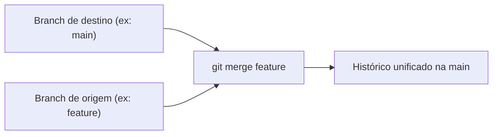

# Guia Prático de `git merge`: Mesclando Branches e Resgatando `detached HEAD`

O comando `git merge` une o histórico de alterações de uma branch (ou estado de trabalho) em outra, por exemplo, trazendo uma nova funcionalidade para a branch principal (`main`).

> [!TIP]
> **Antes de começar:** sempre rode `git status` para garantir que não há arquivos alterados sem commit. Se houver mudanças pendentes, faça um `git commit` ou salve-as temporariamente com `git stash`.

---

## 📋 Índice Rápido

1. [Como funciona o `git merge`](#-1-como-funciona-o-git-merge)
2. [Cenário 1: Merge padrão entre duas branches](#-2-cenário-1-merge-padrão-entre-duas-branches)
3. [Cenário 2: Mesclando a partir de um `detached HEAD`](#-3-cenário-2-mesclando-a-partir-de-um-detached-head)
4. [Tipos de Merge (`fast-forward`, `--no-ff`, `--squash`)](#-4-tipos-de-merge-mais-usados)
5. [Como resolver conflitos de merge (e como abortar)](#-5-como-resolver-conflitos-de-merge)
6. [Boas práticas e comandos de conferência](#-6-boas-práticas-e-conferência)

---

## 🔀 1. Como funciona o `git merge`

No Git, o `git merge` sempre **puxa** as alterações da branch informada **para dentro da branch em que você está no momento**.



> **Regra de ouro:** primeiro vá para a branch que vai **receber** o código (`main`), e só então execute `git merge <nome-da-outra-branch>`.

---

## 🌿 2. Cenário 1: Merge padrão entre duas branches

Use este fluxo quando você já está trabalhando em uma branch normal (ex.: `feature/login`) e quer levá-la para a `main`.

### Passo 1: Mude para a branch principal e atualize-a
```bash
git switch main          # ou: git checkout main
git pull origin main     # garante que a main local está atualizada (se houver remoto)
```

### Passo 2: Execute o merge
```bash
git merge feature/login
```

### Passo 3: Confira o resultado e limpe a branch antiga (opcional)
```bash
git log --oneline --graph --decorate -n 10
git branch -d feature/login
```

---

## 🧭 3. Cenário 2: Mesclando a partir de um `detached HEAD`

Ao rodar `git branch`, você pode se deparar com um estado parecido com este:

```text
* (HEAD detached from 5dabd74)
  main
```

> [!WARNING]
> **Não mude direto para a `main`!**
> Em estado *detached HEAD* (HEAD desanexado), você não está em nenhuma branch nomeada. Se você trocar direto para a `main`, os commits feitos nesse estado ficam "órfãos" e podem se perder quando o Git limpar objetos antigos.

Siga este passo a passo seguro no terminal para **salvar** e **mesclar** esse trabalho na `main`:

### Passo 1: Verifique se há alterações pendentes
```bash
git status
```
Se houver arquivos modificados e ainda não commitados, salve-os antes de criar a branch:
```bash
git add .
git commit -m "chore: salva trabalho pendente antes do merge"
```

### Passo 2: Salve o estado atual em uma branch temporária
Crie uma nova branch exatamente a partir de onde você está (`HEAD detached...`):
```bash
git switch -c temp-branch    # ou: git checkout -b temp-branch
```

### Passo 3: Volte para a branch `main`
```bash
git switch main              # ou: git checkout main
```

### Passo 4: Mescle a branch temporária na `main`
```bash
git merge temp-branch
```

### Passo 5: Remova a branch temporária (opcional)
Depois de confirmar que todos os commits estão na `main` (`git log --oneline -n 5`):
```bash
git branch -d temp-branch
```

> [!NOTE]
> **E se eu já tiver mudado de branch e perdido o commit do `detached HEAD`?**
> Rode `git reflog` para listar o histórico recente do `HEAD`, localize o hash do commit perdido (ex.: `a1b2c3d`) e crie uma branch a partir dele: `git branch resgate a1b2c3d`.

---

## ⚙️ 4. Tipos de Merge mais usados

| Comando | Comportamento | Quando usar |
| :--- | :--- | :--- |
| `git merge <branch>` | **Fast-Forward** (se a `main` não teve novos commits) ou **3-Way Merge** (se houve divergência). | Uso cotidiano rápido e direto. |
| `git merge --no-ff <branch>` | Sempre cria um **merge commit** explícito, mesmo quando daria para avançar direto. | Quando você quer manter registrado no histórico que aqueles commits vieram de uma branch específica. |
| `git merge --squash <branch>` | Junta todos os commits da outra branch na área de *staging* da `main`, sem criar o commit automaticamente (exige `git commit` depois). | Quando a branch de trabalho tem muitos commits de rascunho (*"wip"*, *"fix typo"*) e você quer um único commit limpo na `main`. |

---

## 💥 5. Como resolver conflitos de merge

Se o Git avisar `CONFLICT (content): Merge conflict in <arquivo>`, significa que as duas branches alteraram a **mesma região** do mesmo arquivo.

### Passo 1: Veja quais arquivos estão em conflito
```bash
git status
```

### Passo 2: Edite os arquivos marcados
Abra cada arquivo listado. Você verá blocos delimitados pelo Git assim:

```text
<<<<<<< HEAD
const porta = 3001; // Versão que estava na main
=======
const porta = 8080; // Versão que veio da temp-branch
>>>>>>> temp-branch
```

Escolha qual código manter (ou combine os dois) e **apague completamente** as linhas `<<<<<<<`, `=======` e `>>>>>>>`:

```text
const porta = 3001;
```

### Passo 3: Marque como resolvido e finalize o merge
```bash
git add .
git commit -m "Merge temp-branch into main"
```
*(Dica: rodar apenas `git commit` sem `-m` abre o editor com a mensagem padrão de merge já preenchida.)*

### 🛟 Como cancelar um merge que deu errado
Se você iniciou o merge, viu muitos conflitos e quer voltar tudo exatamente como estava antes:
```bash
git merge --abort
```

---

## ✅ 6. Boas práticas e conferência

* **Confira o histórico visual após o merge:**
  ```bash
  git log --oneline --graph --decorate -n 15
  ```
* **Prefira `-d` em vez de `-D` ao apagar branches:** `git branch -d temp-branch` impede que você apague uma branch que ainda não foi mesclada por acidente.
* **Teste antes de enviar (`push`):** sempre execute os testes ou o build do projeto depois de resolver conflitos de merge, antes de rodar `git push`.
