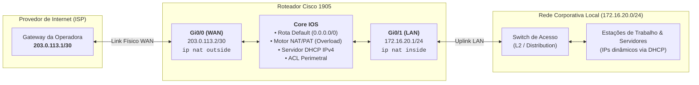

# Configuração Básica de Roteadores Corporativos Cisco

> [!TIP]
> Ao contrário de um roteador doméstico (SOHO), que funciona no modelo *plug and play* com configurações pré-definidas de fábrica, um roteador corporativo (como os das famílias **Cisco 1900, 2900, 4000 ISR**) exige provisionamento manual minucioso via CLI (*Command Line Interface*). Nele, você assume o controle total da arquitetura de rede: ativação e divisão lógica das interfaces, criação de sub-redes, roteamento estático ou dinâmico, servidores DHCP, políticas de NAT/PAT e segurança perimetral via listas de controle de acesso (ACLs).

Este guia prático ensina o passo a passo completo para colocar um roteador Cisco em funcionamento do absoluto zero, garantindo que a rede local (LAN) consiga navegar na internet (WAN) com segurança e boas práticas de administração corporativa.

---

## 📋 Cenário de Referência e Topologia

Para tornar este tutorial imediatamente aplicável, utilizaremos como base um **Cisco 1905 ISR** com duas interfaces Gigabit Ethernet, conectado a um link dedicado de internet (WAN) e a um switch da rede local (LAN).

### Tabela de Endereçamento (Exemplo Prático)

| Parâmetro | Interface / Serviço | Endereço / Faixa | Descrição |
| :--- | :--- | :--- | :--- |
| **WAN (Link Internet)** | `GigabitEthernet0/0` | `203.0.113.2 /30` | IP público fornecido pela operadora |
| **Gateway do Provedor** | Próximo Salto (ISP) | `203.0.113.1` | Gateway padrão para a internet |
| **LAN (Rede Interna)** | `GigabitEthernet0/1` | `172.16.20.1 /24` | Gateway local para as estações e servidores |
| **Faixa DHCP Clientes** | Pool LAN | `172.16.20.50` a `.254` | IPs atribuídos dinamicamente aos PCs |
| **IPs Reservados (Fixos)**| Infraestrutura | `172.16.20.1` a `.49` | Reservados para gateways, switches, impressoras |
| **Servidores DNS** | OpenDNS Primário/Sec. | `208.67.222.222`, `208.67.220.220` | Resolução de nomes externa rápida e segura |

---

### Diagrama da Arquitetura



---

## 🛠️ Modos de Operação do Cisco IOS

Antes de digitar comandos, é fundamental compreender a hierarquia do terminal Cisco:

1. **Modo EXEC Usuário (`Router>`):** Modo de visualização restrita. Digite `enable` para avançar.
2. **Modo EXEC Privilegiado (`Router#`):** Permite inspeção avançada (`show`), testes (`ping`, `traceroute`) e salvamento de configurações. Digite `configure terminal` (ou `conf t`) para editar as configurações.
3. **Modo de Configuração Global (`Router(config)#`):** Onde aplicamos parâmetros gerais do equipamento e acessamos submodos de interfaces, roteamento e serviços.
4. **Modos de Subconfiguração (`Router(config-if)#`, etc.):** Modos específicos para interfaces, pools DHCP, listas de acesso e linhas de terminal.

---

## 🚀 Passo a Passo da Configuração

### 1. Parâmetros Globais e Hardening Inicial

O primeiro passo em qualquer equipamento corporativo é atribuir um nome descritivo, proteger o acesso administrativo e desativar serviços legados inseguros.

```cisco
! Entrar no modo de configuração global
enable
configure terminal

! 1.1 Identificação do Roteador
hostname R1-MATRIZ

! 1.2 Segurança de Acesso Privilegiado (criptografia tipo secret)
service password-encryption
enable secret SuaSenhaPrivilegiadaForte!2026

! 1.3 Desativar resolução de nomes por broadcast no console (evita travamentos ao errar comandos)
no ip domain-lookup

! 1.4 Habilitar CEF (Cisco Express Forwarding) para otimização do tráfego em hardware
ip cef

! 1.5 Configuração de Servidores DNS para o próprio roteador
ip name-server 208.67.222.222
ip name-server 208.67.220.220

! 1.6 Desativar servidor HTTP não seguro (recomenda-se manter apenas HTTPS autenticado ou gerenciar via CLI)
no ip http server
ip http secure-server
ip http authentication local
```

---

### 2. Configuração de Acesso Remoto Seguro (SSH)

Nunca utilize Telnet em ambientes corporativos, pois todo o tráfego de autenticação transita em texto plano. Configure o acesso exclusivo via SSH versão 2:

```cisco
! 2.1 Definir o domínio corporativo (obrigatório para gerar o par de chaves criptográficas)
ip domain-name suaempresa.local

! 2.2 Gerar chave criptográfica RSA (mínimo recomendado de 2048 bits)
crypto key generate rsa modulus 2048

! 2.3 Forçar o uso do protocolo SSH v2
ip ssh version 2

! 2.4 Criar usuário administrador local com privilégio total (nível 15)
username admin privilege 15 secret SenhaSeguraAdmin#2026

! 2.5 Configurar as linhas de acesso remoto (VTY)
line vty 0 4
 transport input ssh
 login local
 exec-timeout 10 0
 logging synchronous
exit
```

---

### 3. Configuração das Interfaces de Rede (WAN e LAN)

Nesta etapa, ativamos as portas físicas, associamos os endereços IP e demarcamos os limites do NAT (`inside` para a rede local e `outside` para a internet).

```cisco
! 3.1 Interface WAN (Conexão direta com a operadora/modem)
interface GigabitEthernet0/0
 description LINK-INTERNET-OPERADORA
 ip address 203.0.113.2 255.255.255.252
 ip nat outside
 ip tcp adjust-mss 1452
 no shutdown
exit

! 3.2 Interface LAN (Gateway da rede interna para o Switch)
interface GigabitEthernet0/1
 description REDE-LOCAL-LAN
 ip address 172.16.20.1 255.255.255.0
 ip nat inside
 no shutdown
exit
```

> [!TIP]
> O comando `ip tcp adjust-mss 1452` ajusta o tamanho máximo de segmento dos pacotes TCP. Isso evita fragmentação de pacotes e lentidão ao carregar páginas web, comum em conexões de banda larga com encapsulamentos extras (como PPPoE).

---

### 4. Rota Padrão (*Gateway of Last Resort*)

Sem uma rota padrão, o roteador não sabe para onde despachar pacotes destinados a endereços desconhecidos na internet. Criamos uma rota estática apontando para o IP do roteador da operadora:

```cisco
! Aponta todo o tráfego externo para o gateway do provedor
ip route 0.0.0.0 0.0.0.0 203.0.113.1
```

---

### 5. Configuração do Servidor DHCP (IPv4)

Para que os dispositivos da rede local recebam automaticamente IP, máscara, gateway e DNS, configuramos o pool DHCP interno do roteador:

```cisco
! 5.1 Reservar faixa de IPs para equipamentos de infraestrutura (Switches, Servidores, Impressoras)
ip dhcp excluded-address 172.16.20.1 172.16.20.49

! 5.2 Criar e configurar o Pool de distribuição dinâmica para estações
ip dhcp pool POOL-LAN
 network 172.16.20.0 255.255.255.0
 default-router 172.16.20.1
 dns-server 208.67.222.222 208.67.220.220
 domain-name suaempresa.local
 lease 1
exit
```

---

### 6. Configuração do NAT / PAT (Masquerade / Overload)

Como os endereços `172.16.20.0/24` são privados (RFC 1918) e não roteáveis na internet pública, o roteador deve traduzi-los dinamicamente para o seu IP público da WAN através de PAT (*Port Address Translation* / *NAT Overload*):

```cisco
! 6.1 Criar uma ACL Standard identificando as sub-redes internas que podem ser traduzidas
access-list 1 permit 172.16.20.0 0.0.0.255

! 6.2 Associar a lista de acesso à interface pública WAN com sobrecarga de portas (Overload)
ip nat inside source list 1 interface GigabitEthernet0/0 overload
```

> [!IMPORTANT]
> A palavra-chave `overload` é indispensável! Ela permite que centenas de máquinas internas naveguem simultaneamente usando o único IP público da interface `GigabitEthernet0/0`, diferenciando cada conexão pela porta TCP/UDP de origem.

---

### 7. Proteção Perimetral com ACLs (Firewall Básico)

Um roteador corporativo deve proteger a si mesmo e à rede interna contra conexões maliciosas originadas da internet.

> [!NOTE]
> **ACL Padrão vs ACL Estendida:**
> - **ACL Padrão (1 a 99):** Analisa apenas o **IP de origem**. Ideal para políticas de NAT e controle de acesso a linhas VTY/SSH. Não é capaz de filtrar portas TCP/UDP.
> - **ACL Estendida (100 a 199 ou Nomeada):** Analisa **IP de origem, IP de destino, protocolo (TCP, UDP, ICMP) e portas L4** (como 80, 443, 22).

#### 7.1 ACL Estendida na Interface WAN (Inbound)

Esta lista bloqueia tentativas de invasão vindas da internet, mas permite o retorno do tráfego legítimo que os próprios usuários internos iniciaram (`established`):

```cisco
! Criar ACL Estendida de proteção na borda WAN
ip access-list extended WAN-FIREWALL-IN
 ! Permite retorno de sessões TCP estabelecidas pelos usuários internos
 permit tcp any any established
 
 ! Permite respostas de DNS (UDP 53) para consultas iniciadas pela rede
 permit udp any eq 53 any
 
 ! Permite mensagens de controle ICMP essenciais (echo-reply, unreachable, time-exceeded)
 permit icmp any any echo-reply
 permit icmp any any unreachable
 permit icmp any any time-exceeded
 
 ! (Opcional) Se você precisar de acesso SSH externo para gerenciamento, restrinja ao IP do seu NOC:
 ! permit tcp host [IP_FIXO_DO_SEU_NOC] any eq 22
 
 ! Bloqueia todo o restante do tráfego não autorizado vindo da internet
 deny ip any any log
exit

! Aplicar a ACL na interface WAN na direção de entrada (in)
interface GigabitEthernet0/0
 ip access-group WAN-FIREWALL-IN in
exit
```

#### 7.2 ACL de Proteção do Acesso Administrativo (VTY / SSH)

Restringe o acesso administrativo via SSH exclusivamente a dispositivos da rede interna autorizada:

```cisco
! Permite gerenciamento apenas a partir da rede local confiável
access-list 10 permit 172.16.20.0 0.0.0.255

line vty 0 4
 access-class 10 in
exit
```

---

### 8. (Opcional) Configuração Dual-Stack IPv6

Caso sua operadora forneça conectividade IPv6 nativa, ative o roteamento e a distribuição de prefixos:

```cisco
! 8.1 Habilitar o roteamento IPv6 no equipamento
ipv6 unicast-routing
ipv6 cef

! 8.2 Configuração da Interface WAN com IPv6
interface GigabitEthernet0/0
 ipv6 address 2001:db8:acad:1::2/64
 no shutdown
exit

! 8.3 Rota Padrão IPv6 apontando para o Gateway do Provedor
ipv6 route ::/0 2001:db8:acad:1::1

! 8.4 Configuração do Pool DHCPv6 Stateless (DNS e Domínio)
ipv6 dhcp pool POOL-DHCPV6
 dns-server 2001:4860:4860::8888
 dns-server 2001:4860:4860::8844
 domain-name suaempresa.local
exit

! 8.5 Interface LAN com SLAAC e DHCPv6 Stateless
interface GigabitEthernet0/1
 ipv6 address 2001:db8:acad:20::1/64
 ipv6 nd other-config-flag
 ipv6 dhcp server POOL-DHCPV6
 no shutdown
exit
```

---

### 9. Salvando as Configurações no NVRAM

No Cisco IOS, as alterações ficam ativas na memória volátil (`running-config`). Para que não sejam perdidas caso o roteador seja reiniciado ou desligado, salve no NVRAM (`startup-config`):

```cisco
! Executar no modo privilegiado (Router#):
end
copy running-config startup-config

! Ou de forma abreviada:
write memory
```

---

## 📜 Script Completo Consolidado (Copy & Paste)

Abaixo está a configuração integral e organizada pronta para implantação em laboratório ou homologação. Substitua os valores de IP pelos fornecidos pela sua operadora:

```cisco
! =====================================================================
! PROJETO: CONFIGURAÇÃO BASE DE ROTEADOR CISCO (WAN + LAN + DHCP + NAT)
! MODELO: CISCO 1905 / SÉRIES ISR G2
! =====================================================================

enable
configure terminal

! --- 1. IDENTIFICAÇÃO E HARDENING ---
hostname R1-MATRIZ
service password-encryption
enable secret SuaSenhaForteAdmin!2026
no ip domain-lookup
ip cef

! --- 2. GERENCIAMENTO REMOTO (SSH) ---
ip domain-name suaempresa.local
crypto key generate rsa modulus 2048
ip ssh version 2
username admin privilege 15 secret SenhaAdminSegura!2026

line con 0
 logging synchronous
 exec-timeout 15 0
line vty 0 4
 transport input ssh
 login local
 access-class 10 in
 exec-timeout 10 0
 logging synchronous

! --- 3. SERVIÇOS WEB E DNS ---
no ip http server
ip http secure-server
ip http authentication local
ip name-server 208.67.222.222
ip name-server 208.67.220.220

! --- 4. POOL DHCP IPv4 (LAN) ---
ip dhcp excluded-address 172.16.20.1 172.16.20.49
ip dhcp pool POOL-LAN
 network 172.16.20.0 255.255.255.0
 default-router 172.16.20.1
 dns-server 208.67.222.222 208.67.220.220
 domain-name suaempresa.local
 lease 1

! --- 5. INTERFACES DE REDE ---
interface GigabitEthernet0/0
 description WAN - CONEXAO PROVEDOR INTERNET
 ip address 203.0.113.2 255.255.255.252
 ip nat outside
 ip access-group WAN-FIREWALL-IN in
 ip tcp adjust-mss 1452
 no shutdown

interface GigabitEthernet0/1
 description LAN - CONEXAO SWITCH REDE LOCAL
 ip address 172.16.20.1 255.255.255.0
 ip nat inside
 no shutdown

! --- 6. ROTEAMENTO PADRÃO ---
ip route 0.0.0.0 0.0.0.0 203.0.113.1

! --- 7. NAT / PAT (OVERLOAD) ---
access-list 1 permit 172.16.20.0 0.0.0.255
ip nat inside source list 1 interface GigabitEthernet0/0 overload

! --- 8. REGRAS DE SEGURANÇA (ACLS) ---
! ACL para restringir o SSH apenas à LAN
access-list 10 permit 172.16.20.0 0.0.0.255

! ACL de proteção perimetral na WAN
ip access-list extended WAN-FIREWALL-IN
 permit tcp any any established
 permit udp any eq 53 any
 permit icmp any any echo-reply
 permit icmp any any unreachable
 permit icmp any any time-exceeded
 deny ip any any log

end
write memory
```

---

## 🔍 Comandos de Validação e Diagnóstico

Após aplicar a configuração, utilize estes comandos no modo privilegiado (`#`) para validar o funcionamento de cada camada:

### 1. Verificar Status das Interfaces
```cisco
show ip interface brief
```
> **Resultado esperado:** As interfaces `GigabitEthernet0/0` e `GigabitEthernet0/1` devem exibir `Status: up` e `Protocol: up`.

### 2. Verificar Tabela de Roteamento
```cisco
show ip route
```
> **Resultado esperado:** Deve constar a linha `Gateway of last resort is 203.0.113.1 to network 0.0.0.0` e a rota `S* 0.0.0.0/0 [1/0] via 203.0.113.1`.

### 3. Verificar Concessões de IP do DHCP
```cisco
show ip dhcp binding
```
> **Resultado esperado:** Lista contendo o endereço IP entregue a cada dispositivo, endereço MAC correspondente e tempo de expiração do *lease*.

### 4. Monitorar Traduções de NAT Ativas
```cisco
show ip nat translations
show ip nat statistics
```
> **Resultado esperado:** Registros mostrando o IP interno (`Inside local`), o IP público traduzido (`Inside global`) com as respectivas portas TCP/UDP em comunicação com destinos externos (`Outside global`).

### 5. Testes de Conectividade Ponto a Ponto
```cisco
! Teste de comunicação com o gateway do provedor
ping 203.0.113.1

! Teste de comunicação com a internet pública
ping 208.67.222.222

! Teste de resolução de nomes DNS externa
ping www.cisco.com
```

---

## ⚠️ Resolução de Problemas Comuns (Troubleshooting)

### 1. Clientes locais não pegam IP via DHCP
- Verifique se a interface `GigabitEthernet0/1` não está em estado `administratively down` (`show ip interface brief`).
- Certifique-se de que o cabo de rede está conectado a uma porta válida do Switch com a VLAN correta.
- Confira se o pool DHCP não esgotou os endereços disponíveis com o comando `show ip dhcp pool POOL-LAN`.

### 2. Dispositivos pingam o roteador, mas não navegam na internet
1. **Verifique a Rota Padrão:** Certifique-se de que a rota `0.0.0.0 0.0.0.0` aponta para o IP correto do gateway do seu ISP (`show ip route`).
2. **Verifique as marcações de NAT:** Confirme que a porta WAN possui `ip nat outside` e a porta LAN possui `ip nat inside`.
3. **Verifique a regra de sobrecarga:** Confirme se o comando `ip nat inside source list 1 interface GigabitEthernet0/0 overload` está presente no `show running-config | include nat`.
4. **Verifique o DNS:** Se o ping para `8.8.8.8` funcionar mas a navegação web falhar, os clientes locais estão com problemas de DNS. Verifique se o IP dos servidores DNS foi informado no pool DHCP.

### 3. Navegação lenta ou falha ao abrir páginas HTTPS grandes
- Conexões com cabeçalhos adicionais (ex: túneis VPN ou conexões PPPoE da operadora) podem exceder a MTU padrão de 1500 bytes.
- Certifique-se de ter aplicado `ip tcp adjust-mss 1452` na interface WAN (`GigabitEthernet0/0`).

### 4. Bloqueio inadvertido por ACL
- Se a conectividade parou após a aplicação da ACL na WAN, verifique a contagem de pacotes descartados:
  ```cisco
  show access-lists WAN-FIREWALL-IN
  ```
- O comando exibe o número de ocorrências (*matches*) em cada linha da regra, permitindo identificar se tráfego legítimo está caindo na linha `deny ip any any`.

---

> [!CAUTION]
> **Aviso de Ambiente de Produção:**
> As configurações aqui apresentadas constituem uma base funcional sólida e segura para operação geral. Para ambientes corporativos críticos, recomenda-se complementar esta arquitetura com:
> - Inspeção de estado avançada com **Cisco Zone-Based Policy Firewall (ZFW)** ou firewalls dedicados de próxima geração (NGFW como FortiGate, Palo Alto, Cisco Firepower).
> - Criação de múltiplas VLANs com subinterfaces 802.1Q (Router-on-a-Stick) para segmentar departamentos, rede de visitantes (*Guest*) e servidores.
> - Monitoramento remoto via SNMPv3 e sincronização de horário com servidores NTP corporativos.
